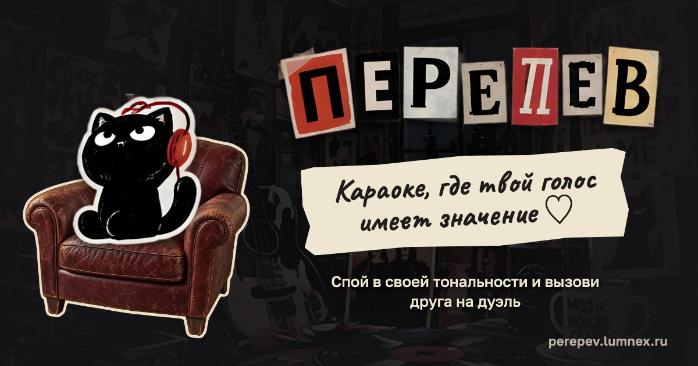

# Перепев

Караоке с оценкой пения, тренировкой трудных фрагментов, дуэлями и совместным исполнением. Можно петь в удобной тональности: алгоритм учитывает сдвиг голоса относительно эталона, а затем сравнивает мелодию и ритм.

Проект команды **MugSize** для хакатона **«Время IT» от ГУАП**. Сайт уже развёрнут: **[perepev.lumnex.ru](https://perepev.lumnex.ru)**.

В репозитории — новая версия из папки `Perepev 3`. Клиент написан на SvelteKit, API и общее ядро оценки — на Rust. Нейросети работают на собственном компьютере команды.

**[Презентация для защиты](presentation/Презентация_Mugsize.pptx)** · [Краткое описание](PROJECT_OVERVIEW.md) · [Архитектура](ARCHITECTURE.md)



## Запуск

Нужны Docker с Compose и интернет для первой сборки. Музыка, шрифты и изображения уже включены.

```sh
git clone https://github.com/jfghmrr/VremyaITHack.git
cd VremyaITHack
docker compose up --build -d --wait --wait-timeout 180
```

Открой [localhost:8080](http://localhost:8080), разреши микрофон и надень наушники. Без дополнительных настроек доступны каталог, браузерная оценка, кабинет, дуэли и режим «Вместе». Для точной оценки и подготовки своих треков нужен GPU-обработчик; для Яндекс ID и VK ID — ключи приложений.

```sh
docker compose ps
docker compose logs --tail=100 api
docker compose down
```

Остановка сохраняет данные в томах Docker. Команда `down -v` удаляет их. Пошаговая инструкция и решение частых проблем — [START_HERE.md](START_HERE.md).

## Что работает

- 32 вокальных фрагмента: 14 русских и 18 английских. Есть поиск, языковые фильтры, прослушивание и сведения о правах на каждую запись.
- Одиночное пение с живой линией голоса, подсветкой слов, разбором результата и повтором трудного места.
- Два режима звука: минус с тихой вокальной подсказкой в наушниках или только минус с подавлением эха.
- Предварительный балл в браузере и серверная оценка с проверкой слов при доступном GPU-обработчике и согласии на передачу записи.
- «Мои треки»: выбор отрывка 15–60 секунд, подготовка караоке, исправление распознанных слов и времени их появления. Файлы доступны только владельцу в течение суток.
- Живые дуэли по ссылке, рейтинговый подбор и асинхронный вызов-призрак.
- Режим «Вместе»: двое поют по очереди, получают общий балл и могут послушать запись с настоящими голосами, если оба согласились поделиться ими.
- Мобильное меню, компактная проверка микрофона и сцена пения для телефона.
- Кабинет, друзья по коду, история, достижения, выгрузка и удаление своих данных.

Точная оценка применяется к одиночному пению. Дуэли и режим «Вместе» используют базовый алгоритм по кривым высоты: сервер пересчитывает результат, но не проверяет слова нейросетью.

## Устройство проекта

```text
Браузер → Caddy → Rust API → PostgreSQL
                     ├───→ Valkey
                     └───→ приватные файлы

GPU-обработчик → HTTPS API → задания и результаты
```

На действующем сервере перед Caddy стоит nginx с HTTPS. Обработчик на Windows-ПК сам забирает задания; входящие порты на нём не открываются. Если он недоступен, сайт оставляет браузерную оценку с подписью «слова не проверены».

| Каталог | Содержимое |
| --- | --- |
| `web` | Интерфейс, браузерное аудио, WASM-клиент и тесты. |
| `crates/scoring-core` | Общая логика оценки. |
| `crates/scoring-wasm` | Привязки ядра для браузера. |
| `crates/api` | API, матчи, аккаунты, задания и миграции базы. |
| `gpu-worker` | Разделение дорожек, извлечение мелодии, распознавание слов. |
| `contracts` | JSON-схемы обмена с клиентом. |
| `presentation` | Презентация для защиты. |
| `deploy` | Caddy, nginx, резервные копии и установка обработчика. |
| `tests/integration` | Проверки API с настоящими PostgreSQL и Valkey. |

## Документация

- [Описание проекта](PROJECT_OVERVIEW.md) и [проделанная работа](WORK_DONE.md).
- [Архитектура](ARCHITECTURE.md) и [почему выбраны эти технологии](docs/technology-decisions.md).
- [Запуск и обслуживание](OPERATIONS.md), [вход через Яндекс и VK](docs/oauth-setup.md), [GPU-обработчик](deploy/gpu-worker/README.md).
- [Протокол](docs/protocol.md), [ограничения](ASSUMPTIONS.md), [проверка перед публикацией](docs/release-check.md).
- [Музыкальный каталог](docs/vocal-catalog.md), [лицензии](LICENSES.md), [измерения GPU-оценки](gpu-worker/bench/RESULTS.md).

## Разработка

Версии Rust, Node и зависимостей зафиксированы в `rust-toolchain.toml`, `Dockerfile`, `Cargo.lock` и `web/package-lock.json`. Для работы вне Docker нужны Rust с целью `wasm32-unknown-unknown`, wasm-bindgen-cli 0.2.129 и Node 26.11.1.

```sh
cd web
npm ci
npm run check
npm test
npm run build
```

`npm test` и `npm run build` сначала собирают WASM. Rust-проверки: `cargo test --release --workspace` и `cargo clippy --release --workspace --all-targets -- -D warnings`. Браузерные и интеграционные тесты запускают на отдельной базе: они создают пользователей и матчи. Примеры команд находятся в [отчёте проверки](docs/release-check.md). Автоматический запуск проверок в GitHub Actions отключён.

## Ограничения

Пороги оценки ещё нужно проверять на живых певцах. Большая задержка Bluetooth, ошибки распознавания слов и неточности эталона могут снизить балл. Синтетические тесты и эмуляция размеров экрана не заменяют испытания реальных телефонов. У трёх старых русских записей проверка слов отключена; подробности есть в каталоге.

Код распространяется по MIT. Музыка и её переработки сохраняют условия своих лицензий. Приватная загрузка файла не отменяет прав на него. `.env`, ключи, базы, кеши моделей и резервные копии в Git не включаются.
